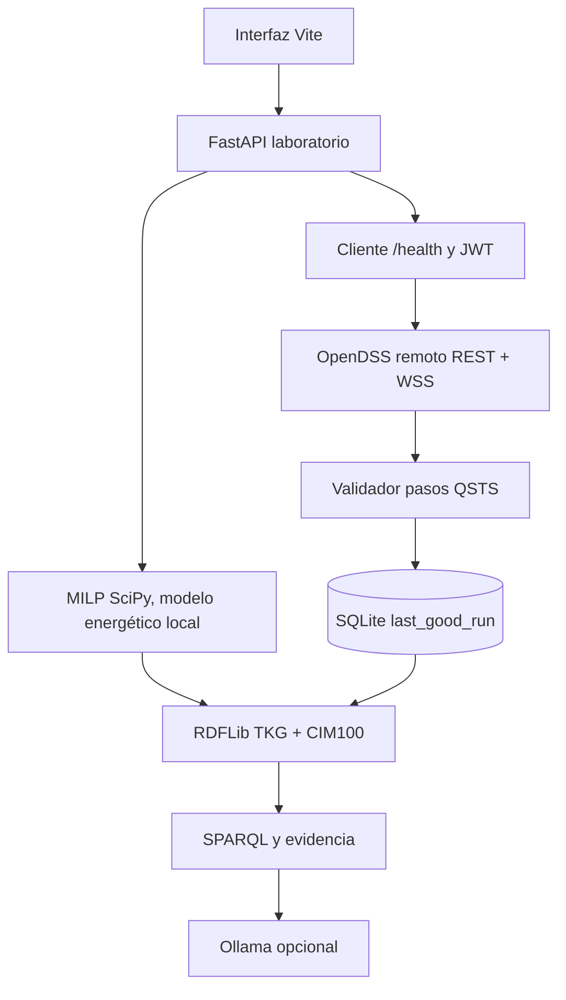

# Arquitectura

* Dos escenarios distintos: `remote_qsts_baseline_verified` frente a `dispatch_energy_model_only`. Una decisión BESS local NO modifica el circuito remoto con la API actual.
* `active_run` contiene resultado provisional; `last_good_run` apunta exclusivamente a corrida QSTS remota completa, validada y persistida en una transacción.
* XML CIM100 de IEEE13 se carga de la carpeta aportada. La conexión BESS→bus671 se **modela** y queda identificada como tal.
* El perfil Ausgrid es histórico, no telemetría en tiempo real. Los timestamps de Ausgrid son UTC y `recordedAt` es el momento en el que el laboratorio guardó el RDF.
* No calcular SAIDI/SAIFI en este MVP. No asumir que ejecutar la QSTS verifica protección, islas o continuidad de servicio.
